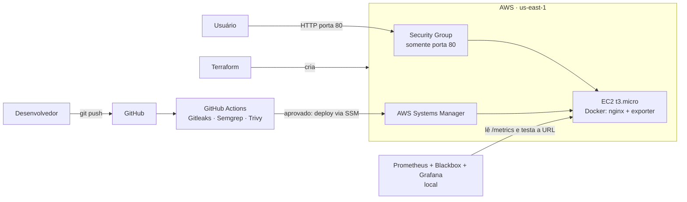

# Alerta de Chuva Forte e Alagamento · Grande SP

**Deploy Blindado** · 3.6. Secure DevOps Tools & Cloud Computing (Componente: Produção)
Professor: Cleórbete Santos · GS 2026.2 · CitizenTech

## Integrantes

| Nome completo | RM |
|---|---|
| Arthur Baldissera Claumann Marcos | RM550219 |
| Victor Kenzo Toma | RM551649 |
| Ricardo Ramos Vergani | RM550166 |
| Pedro Barros | RM97937 |

---

## Ficha Técnica do MVP

| Item | Descrição |
|---|---|
| Nome | Alerta Chuva SP · Alerta de Chuva Forte e Alagamento na Grande SP |
| Problema | Avisar o cidadão de São Paulo quando vai chover forte no município dele e mostrar onde há relatos de alagamento, para planejar o deslocamento com segurança |
| O que está no ar | Página web estática (`mvp/`) que lê o extrato da camada Ouro (`mvp_alertas.json`) |
| URL pública (AWS, publicada pelo pipeline) | http://54.85.25.247 |
| Cópia no GitHub Pages (sempre disponível) | https://zbaldd.github.io/GS-BIGDATA-2026/mvp/ |
| Nuvem | AWS (AWS Academy Learner Lab), região us-east-1, EC2 t3.micro com IP elástico |
| Stack | nginx (container), Docker Compose, Terraform, GitHub Actions (Gitleaks, Semgrep, Trivy), AWS SSM, Prometheus, Blackbox Exporter, Grafana |
| Integrantes | Ver a tabela de integrantes acima |

> **Disponibilidade da URL da AWS:** o AWS Academy desliga as instâncias EC2 ao fim de cada sessão do laboratório. Para acessar, dê **Start Lab** e, no console, inicie a instância `gs-alerta-chuva` (EC2 → Instâncias → Iniciar instância). O IP é fixo (Elastic IP) e os containers sobem sozinhos. Enquanto isso, o mesmo MVP fica disponível no GitHub Pages (link acima).

A entrega em PDF (diagrama, prints de evidência e estimativa de custo) acompanha este repositório.

## Estrutura do repositório

```text
Dockerfile                  imagem do MVP (nginx, usuário não-root)
docker-compose.mvp.yml      stack do MVP (nginx + exporter de métricas)
nginx/default.conf          configuração do nginx (site + /metrics)
mvp/                        página do MVP e dados (mvp_alertas.json)
infra/                      Terraform (Security Group, EC2, IP elástico)
monitoring/                 Prometheus, Blackbox Exporter e Grafana (rodam localmente)
.github/workflows/          pipeline DevSecOps (GitHub Actions)
```

> `docker-compose.yaml` e `docker-compose.override.yml` na raiz, assim como `dags/`, `databricks/` e `amostras/`, pertencem ao pipeline de dados (Airflow/Databricks) que gerou o MVP. **Não fazem parte deste deploy.** A stack do MVP é a do `docker-compose.mvp.yml`.

---

## Arquitetura



---

## Como reproduzir

1. **Container local:** `docker compose -f docker-compose.mvp.yml up --build -d` e abra http://localhost.
2. **Infraestrutura:** coloque as chaves do AWS Academy em `~/.aws/credentials`, entre em `infra/`, copie `terraform.tfvars.example` para `terraform.tfvars` e rode `terraform init`, `terraform plan` e `terraform apply`. Anote a saída `instance_id`.
3. **Pipeline:** em Settings → Secrets and variables → Actions, cadastre `AWS_ACCESS_KEY_ID`, `AWS_SECRET_ACCESS_KEY`, `AWS_SESSION_TOKEN` (as três mudam a cada Start Lab) e `INSTANCE_ID` (`terraform output instance_id`). Cada push roda Gitleaks, Semgrep, build e Trivy; na `main`, o deploy é automático.
4. **Monitoramento:** copie `monitoring/.env.example` para `monitoring/.env`, defina a senha do Grafana e rode `docker compose up -d` em `monitoring/`. Prometheus em http://localhost:9090 e Grafana em http://localhost:3000 (painel **MVP - 4 Sinais de Ouro**).

---

## Segurança aplicada

- Imagem enxuta (Alpine), usuário **não-root** (`nginx`), pacotes atualizados e nenhum segredo dentro da imagem.
- `terraform.tfstate`, `*.tfvars` e `.env` ficam **fora do repositório** (`.gitignore`); só os modelos `*.example` são versionados.
- **Nenhuma porta de administração aberta.** O Security Group libera só a porta 80; não há SSH. Administração e deploy usam o AWS Systems Manager (SSM).
- Disco da instância criptografado e metadados da instância protegidos (IMDSv2).
- Segredos apenas em **GitHub Secrets**; ferramentas do pipeline fixadas por SHA de commit (proteção contra ataque à cadeia de suprimentos).
- **Exceção aceita no Semgrep:** o `proxy_pass` de `/metrics` tem destino fixo (não controlado pelo visitante), e a regra `missing-internal` foi marcada com `nosemgrep`.
- **Risco aceito:** `/metrics` é público, pois o Prometheus local precisa lê-lo pela URL do MVP. Ele expõe só contadores do nginx. Melhoria futura: restringir por IP ou exigir autenticação.

## Observabilidade (4 sinais de ouro)

| Sinal | Como medimos |
|---|---|
| Latência | `probe_duration_seconds` (Blackbox Exporter, testando de fora) |
| Tráfego | `rate(nginx_http_requests_total[2m])` |
| Erros | % de checagens com falha (`probe_success`) e status HTTP da última checagem |
| Saturação | `nginx_connections_active` (limite padrão de 1024) |

**Alertas** (`monitoring/alerts.yml`): `SiteForaDoAr` (checagem falha por 30 s) e `LatenciaAlta` (resposta acima de 1 s por 1 min).
Para reproduzir o disparo sem derrubar o servidor, aponte temporariamente o alvo `site-blackbox` de `monitoring/prometheus.yml` para uma porta fechada (por exemplo `http://54.85.25.247:8081/`), rode `docker compose restart prometheus` e abra http://localhost:9090/alerts. Depois volte o alvo para `http://54.85.25.247/`.

---

## Matriz de responsabilidade compartilhada

| Camada | AWS | Equipe |
|---|---|---|
| Datacenter físico, hardware, rede global e hipervisor | Responsável | — |
| Mecanismos de firewall (Security Group) e de criptografia (EBS/KMS) | Fornece o serviço | Configura as regras e ativa a criptografia |
| Sistema operacional da instância e atualizações | — | Responsável |
| Docker, imagem e dependências | — | Responsável (Trivy no pipeline) |
| Código do MVP e dados publicados | — | Responsável |
| Identidades, credenciais e segredos | Fornece o IAM/SSM (LabRole do Academy) | Guarda em GitHub Secrets e rotaciona |
| Pipeline CI/CD | — | Responsável (o GitHub fornece a plataforma) |
| Monitoramento e resposta a alertas | Fornece métricas da infraestrutura | Responsável (Prometheus/Grafana) |

## LGPD: localização e proteção dos dados pessoais

- **No servidor da AWS (us-east-1) não há dados pessoais do cidadão.** O MVP publica só o extrato agregado por município (chuva, população e contagem de relatos); nenhum dado pessoal vai para o MVP.
- Dados pessoais existem apenas na **camada de relatos**, que é **simulada** (nomes aleatórios e e-mails no domínio reservado `.invalid`), no pipeline Airflow/Databricks do grupo.
- O nginx registra o **endereço IP** de quem acessa (dado pessoal pela LGPD). Os logs ficam apenas no container, sem envio a terceiros, e são descartados quando o container é recriado.
- Infraestrutura: disco criptografado, acesso administrativo somente por SSM e nenhuma porta de administração exposta.

| Dado pessoal | Onde aparece | Tratamento |
|---|---|---|
| Nome | Relatos (Databricks) | Não levado adiante (minimização) |
| E-mail | Relatos (Databricks) | Hash com sal guardado fora do repositório |
| Telefone | Relatos (Databricks) | Mascarado |
| Localização exata | Relatos (Databricks) | Arredondada (~100 m) |
| Endereço IP do visitante | Logs do nginx (container na AWS) | Sem envio a terceiros; descartado ao recriar o container |

## Estimativa de custo na nuvem (AWS, us-east-1, uso 24x7)

| Item | Cálculo | US$/mês |
|---|---|---|
| EC2 t3.micro (on-demand) | 730 h × US$ 0,0104 | ≈ 7,59 |
| IPv4 público (Elastic IP) | 730 h × US$ 0,005 | ≈ 3,65 |
| Disco EBS gp3 de 8 GB | 8 GB × US$ 0,08 | ≈ 0,64 |
| Transferência de saída | tráfego baixo, dentro da franquia gratuita mensal | ≈ 0 |
| **Total estimado** | | **≈ 11,9** |

Valores de tabela (preço sob demanda); para o orçamento oficial, use a AWS Pricing Calculator. GitHub Actions (repositório público) e Prometheus/Grafana (rodam localmente) não têm custo. No AWS Academy não há cobrança real (orçamento do laboratório: US$ 50).
